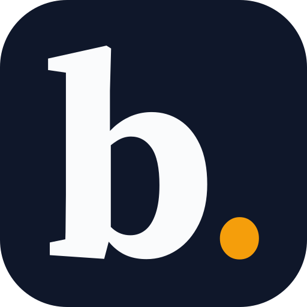
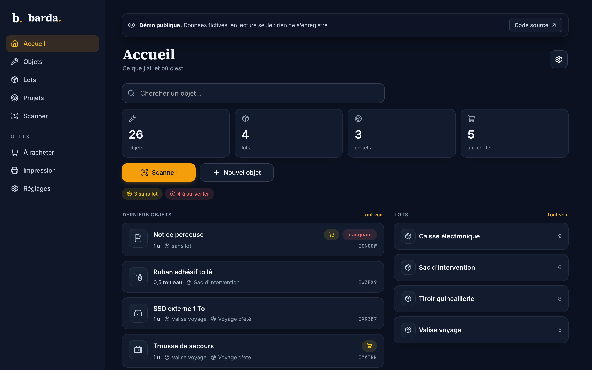
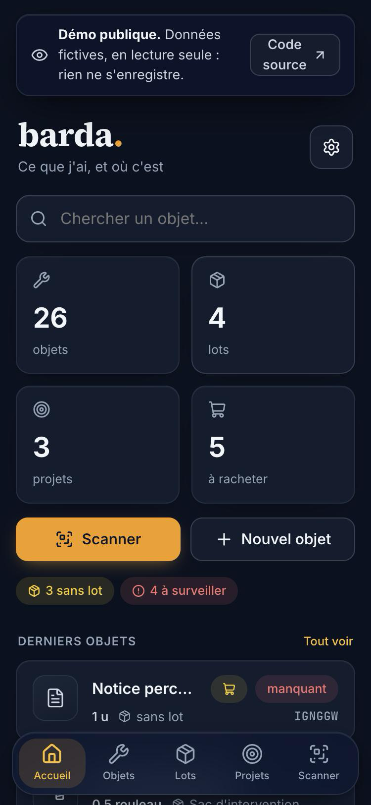
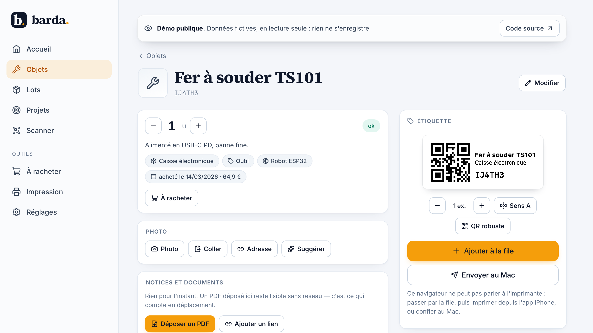

<p align="center">
  
</p>

<h1 align="center">barda.</h1>

<p align="center">
  Ce que j'ai, dans quel sac, et pour quel projet.<br>
  Un inventaire du matériel pensé pour le téléphone, avec des étiquettes QR imprimées en Bluetooth.
</p>

<p align="center">
  <a href="https://showcase-barda.can-ali.fr"><b>Voir la démo</b></a> ·
  <a href="#installer">Installer</a> ·
  <a href="#imprimantes-prises-en-charge">Imprimantes</a> ·
  <a href="https://github.com/Lyniiiix/barda-ios">App iOS</a>
</p>

<p align="center">
  <br>
  
  
</p>

> **In English.** Barda is a self-hosted inventory for tools and gear: items, the bags or boxes
> they live in (*lots*), and the projects they serve. Each item and lot gets a 12 mm QR label
> printed over Bluetooth (Fichero D11s today, more printers can be added). Scan a label to open
> the item, or scan a series to put things away. Next.js + SQLite, one Docker container, an MCP
> server so an AI assistant can read and update the inventory. The UI is in French.

## Le modèle

Trois objets, et c'est tout :

| | Code | À quoi ça sert |
|---|---|---|
| **Objet** | `I…` | Une chose. Un fer à souder, un disque dur, un rouleau de gaine, une trousse de secours. Nom, description libre, quantité et unité, catégorie, état, photo, notices. |
| **Lot** | `L…` | *Où* c'est rangé : un sac, une caisse, un tiroir. Nommé « Lot 1 », « Lot 2 »… par défaut. Un objet est dans zéro ou un lot. |
| **Projet** | `P…` | *À quoi* ça sert : « Voiture enfant », « Support CAN ». Un objet peut servir à plusieurs projets. |

La fiche d'un projet répond à la seule question qui compte au moment de charger la voiture :
**quels lots embarquer**.

Chaque objet et chaque lot porte un code court à 6 caractères (`IR7MCX`, `LGJWAQ`). L'alphabet
exclut `I`, `L`, `O` et `U`, illisibles sur une étiquette de 12 mm.

## État, et liste de courses

Deux choses différentes, volontairement séparées :

- **l'état** décrit la chose : `ok`, `usé`, `à réparer`, `à remplacer`, `prêté`, `manquant` ;
- **« à racheter »** est une intention, pas un état. Un tournevis neuf peut être sur la liste de
  courses parce qu'on en veut un deuxième ; un foret usé peut ne pas y être parce qu'on s'en
  contente.

La page `/courses` rassemble tout ce qui est à reprendre. Un objet y arrive de cinq façons :
coché à la main, **quantité tombée à zéro**, **passé sous son seuil**, porté manquant, ou
**date de renouvellement passée** (une trousse de secours, un extincteur). Chaque ligne dit
*pourquoi*, et « Racheté » remet le stock et sort l'objet de la liste.

Le **seuil** (`min_qty`) évite d'avoir à y penser : trois rouleaux d'étain avec un seuil à 1, et
l'étain remonte tout seul le jour où il n'en reste qu'un. À 0, pas de seuil : c'est le défaut,
pour ne pas imposer de compter ce qu'on ne veut pas compter.

## Photos, notices et documents

Sans photo, l'objet affiche **l'icône de sa catégorie** : il n'y a jamais de vignette vide.
Quatre façons d'en mettre une, dans cet ordre d'utilité :

| | |
|---|---|
| **Photo** | l'appareil du téléphone, réduite à 1024 px **dans le navigateur** avant l'envoi. |
| **Coller** | le vrai chemin pour un produit précis : copier l'image sur la page du vendeur, coller ici. |
| **Adresse** | une URL d'image, récupérée côté serveur (le navigateur ne peut pas, à cause de CORS). |
| **Suggérer** | Unsplash et Wikipédia, **proposés puis validés à l'œil**, jamais appliqués tout seuls. |

Pourquoi pas de récupération automatique : mesuré avant d'écrire la moindre ligne, Wikipédia
répond juste sur le générique (perceuse, multimètre) mais « tresse à dessouder » renvoie le dieu
égyptien Seth, et scraper une boutique casse en silence. **Une photo fausse est pire qu'une icône.**

Chaque objet porte aussi des documents : **un PDF déposé** ou **un lien**. Les deux existent, mais
un lien ne s'ouvre pas sans réseau ; pour du matériel qui part loin, c'est le fichier qui compte.

## Étiquettes

Le QR encode le **code nu** (`IR7MCX`), pas une adresse. Mesuré sur les 90 px de haut disponibles :

| Contenu | Modules | Taille de module | Correction d'erreur |
|---|---|---|---|
| adresse `https://…/s/…` | 25×25 | 0,38 mm | L : 7 % |
| **code nu `IR7MCX`** | **21×21** | **0,50 mm** | **Q : 25 %** |

**+32 % de module et 3,5× plus de correction**, pour le même encombrement. Sur une étiquette
pliée, sale ou vue de loin, c'est la différence entre lire et ne pas lire. Le bouton **QR lien**
rétablit l'adresse (seule l'adresse permet à l'appareil photo d'iOS d'ouvrir la fiche
directement) ; le scanner de l'app lit les deux.

Le scanner intégré (`/scan`) sert à deux choses : **consulter** (scan, la fiche s'ouvre) et
**ranger** (on choisit un lot, puis on scanne les objets à la chaîne). Un code-barres de
fabricant inconnu propose de créer l'objet avec ce code.

**Calage.** Si l'imprimante coupe un bord de l'étiquette, les flèches sous l'aperçu décalent tout
le contenu par pas de 0,5 mm, et l'aperçu montre exactement ce qui sortira. Le réglage est gardé
dans le navigateur et vaut pour les deux sens ; la D11s part avec +2,5 mm, mesuré sur des
étiquettes de 12 × 30 mm.

### La file d'impression

Un bouton qui imprime au premier appui coûte cher : un double appui, une étiquette de trop. Le
chemin normal est donc **le panier** : on ajoute à la file depuis les fiches, la page
`/impression` montre **une carte par étiquette avec son aperçu réel**, et rien ne sort tant qu'on
ne l'a pas demandé. Au-delà de dix étiquettes, l'impression demande une confirmation ; une
coupure en cours de série n'acquitte que ce qui est sorti ; chaque fiche dit « imprimée le … ».

## Imprimantes prises en charge

| Imprimante | Étiquettes | Navigateur (Web Bluetooth) | App iOS | Relais Mac |
|---|---|---|---|---|
| **Fichero D11s** | 12 × 30 mm, 203 dpi | Chrome, Edge | oui | oui |

Safari **n'expose pas le Bluetooth** aux pages web, ni sur iPhone ni sur Mac. D'où trois chemins,
que la page choisit toute seule :

| Contexte | Chemin | Ce qu'il faut |
|---|---|---|
| App iOS [`barda-ios`](https://github.com/Lyniiiix/barda-ios) | pont natif vers CoreBluetooth | l'app installée |
| Chrome / Edge, sur ordinateur ou Android | Web Bluetooth | rien |
| Safari, ou n'importe quoi d'autre | « Confier au Mac », puis le relais | `npm run spool` qui tourne sur un Mac |

Le relais imprime via la CLI de [`fichero-printer`](https://github.com/0xmh/fichero-printer), et
doit être lancé **depuis Terminal.app** : macOS n'accorde le Bluetooth qu'aux processus dont le
parent y a droit.

```bash
BARDA_URL=https://barda.example.com BARDA_PRINT_TOKEN=… npm run spool
```

### Ajouter une imprimante

1. **Décrire le modèle** dans `src/lib/printers/models.ts`, en ajoutant une entrée à `PRINTERS` :
   - un `id` stable (`marque-modele`), qui ne changera plus ;
   - le `name` affiché, le `dpi`, la largeur de tête `headDots` et `bytesPerRow` ;
   - les formats d'étiquette dans `labels` (largeur dans le sens de la tête, longueur dans le sens du papier) ;
   - la plage de `density` et les `transports` réellement pris en charge.
   - au besoin `feedOffsetMm`, le calage par défaut si la machine démarre à côté du bord.

   Le rendu s'adapte seul : la hauteur de l'étiquette suit le modèle, le gabarit garde ses proportions.
2. **Navigateur** : écrire un pilote `src/lib/printers/<id>.ts` qui renvoie un `PrinterDriver`.
   Il reçoit une trame 1 bit déjà encodée et la transmet. L'inscrire dans la table `WEB_BLUETOOTH`
   de `src/lib/printers/index.ts`.
3. **iPhone** : dans `barda-ios`, écrire `Barda/<Modele>.swift`, une classe conforme à
   `LabelPrinter`, avec le même `id` et le même `bytesPerRow` que côté web, puis l'ajouter à
   `Printers.catalog` dans `Barda/Printers.swift`.
4. **Relais** : ajouter une entrée à `RELAY` dans `scripts/spool.mjs`, avec la commande qui
   imprime un PNG, choisie par `BARDA_PRINTER=<id>`.
5. Tant qu'il n'y a qu'une imprimante, `activePrinter()` la renvoie directement : c'est le seul
   endroit à transformer en réglage pour en gérer plusieurs.

Un transport non implémenté pour un modèle ne casse rien : la page propose les chemins restants.
Les contributions pour d'autres étiqueteuses Bluetooth (Niimbot, Phomemo…) sont bienvenues.

## Installer

Un seul conteneur, une base SQLite, un volume. Avec Docker Compose :

```bash
git clone https://github.com/Lyniiiix/barda.git && cd barda
cp .env.example .env        # puis BARDA_PASSWORD et BARDA_SECRET au minimum
docker compose up -d        # écoute sur 127.0.0.1:3000
```

Mets-le derrière ton reverse proxy HTTPS habituel : **la caméra du téléphone n'est accessible
qu'en HTTPS**. Pour ma part, Barda tourne sous **Coolify**, derrière son **Traefik** : un projet
avec ce dépôt comme source, le `Dockerfile` comme méthode de build, un volume persistant sur
`/data`, et les variables d'environnement ci-dessous. Caddy, Nginx Proxy Manager ou un tunnel
font aussi bien l'affaire.

⚠️ **Utilise le `Dockerfile`**, pas une détection automatique : `node:sqlite` exige Node ≥ 24, et
nixpacks choisit Node 22 (`ERR_UNKNOWN_BUILTIN_MODULE`).

| Variable | Rôle |
|---|---|
| `BARDA_PASSWORD` | mot de passe unique d'accès (obligatoire en production) |
| `BARDA_SECRET` | clé HMAC du cookie de session, `openssl rand -hex 32` (obligatoire en production) |
| `BARDA_DB` | chemin du fichier SQLite (`/data/barda.db` dans le conteneur) |
| `BARDA_PRINT_TOKEN` | jeton du relais d'impression (en-tête `x-barda-token`) |
| `BARDA_MCP_TOKEN` | jeton du serveur MCP ; sans lui, `/api/mcp` refuse tout |
| `UNSPLASH_ACCESS_KEY` | optionnel : suggestions de photos Unsplash |
| `BARDA_DEMO` | `1` pour le mode démo (voir plus bas) |
| `BARDA_SIGNATURE` | pied de page : vide pour « Conçu par can.sys », `off` pour le retirer |
| `BARDA_CF_ACCESS_TEAM` · `BARDA_CF_ACCESS_AUD` | derrière Cloudflare Access : nom de l'équipe et `aud` de l'application ; Barda refuse alors toute requête sans jeton Access valide |

**Sécurité.** L'accès tient en un mot de passe et un cookie signé d'un an, et le site est en
`noindex`. Sur un domaine public, mets une porte devant : un réseau privé (Tailscale) ou
Cloudflare Access. Avec Access, pose `BARDA_CF_ACCESS_TEAM` et `BARDA_CF_ACCESS_AUD` : Barda
vérifie alors lui-même la signature du jeton que Cloudflare ajoute à chaque requête, ce qui
ferme le contournement par l'IP de l'origine. Laisse hors d'Access `/api/mcp` et
`/api/print-queue`, appelés par des machines qui ont chacune leur jeton. La sonde de santé du
conteneur est `/api/sante`.

**Sauvegarde.** `Réglages ▸ Exporter en JSON` sort tout (objets, lots, projets, liens). Les photos
et les PDF sont dans le volume, à côté de la base : sauvegarde le volume entier.

## Mode démo

`BARDA_DEMO=1` ouvre l'app sans mot de passe, sur un inventaire fictif créé au premier démarrage,
**en lecture seule** : le middleware refuse toute requête qui écrit (formulaire, action serveur,
envoi de fichier), ainsi que le MCP, le relais et les suggestions de photos. C'est ce qui tourne
sur [showcase-barda.can-ali.fr](https://showcase-barda.can-ali.fr).

## Le serveur MCP

`POST /api/mcp` : un serveur MCP (JSON-RPC, transport HTTP, sans état) servi par l'app elle-même,
pour qu'un assistant puisse consulter et tenir l'inventaire.

```bash
claude mcp add --transport http barda https://barda.example.com/api/mcp \
  --header "Authorization: Bearer $BARDA_MCP_TOKEN"
```

| Outil | |
|---|---|
| `inventaire_apercu` | vue d'ensemble : totaux, lots, projets, ce qui cloche. Le point d'entrée. |
| `objets_chercher` · `objet_lire` | recherche et détail |
| `lots_lister` · `projets_lister` | les contenants et les usages |
| `projet_besoins` | ce qu'il faut pour un projet, **groupé par lot**, donc quoi embarquer |
| `objet_ajouter` · `objet_modifier` | création et modification partielle |
| `objet_ranger` · `stock_ajuster` · `stock_reappro` | changer de lot, décompter, racheter |
| `objet_document_lier` · `a_racheter_lister` | notices et liste de courses |
| `lot_creer` · `projet_creer` | nouveaux contenants et projets |

**Aucun outil ne supprime.** Un modèle peut se tromper de code, et un objet effacé ne se retrouve
pas. Les écritures passent par `src/lib/mutations.ts`, exactement le même code que les formulaires.

## Développement

```bash
npm install
npm run dev     # http://localhost:3210, mot de passe « barda » hors production
```

Node ≥ 24 obligatoire. Base **SQLite** par `node:sqlite` : aucune dépendance native, aucun ORM,
le schéma est en haut de `src/lib/db.ts` et se crée tout seul au démarrage. Pour travailler sur
des données d'exemple : `BARDA_DEMO=1 BARDA_DB=/tmp/demo.db npm run dev`.

## La DA

Barda fait partie de la « Suite » de can.sys : une tuile nuit, une initiale en serif
(Source Serif 4), un point de couleur propre à chaque app (ambre pour Barda), Inter pour le texte
et JetBrains Mono pour les codes. Les icônes viennent de [Lucide](https://lucide.dev).

## Crédits et licence

- Protocole BLE de la D11s : [0xmh/fichero-printer](https://github.com/0xmh/fichero-printer) (MIT),
  dont la partie web dérive de [NiimBlue](https://github.com/MultiMote/niimblue) (MIT). Voir
  `src/lib/fichero/NOTICE.md`.
- Lecture des codes : [ZXing](https://github.com/zxing-js/library) (Apache 2.0).
- Icônes : [Lucide](https://lucide.dev) (ISC). Polices : Inter, Source Serif 4, JetBrains Mono (OFL).

Barda est sous licence [MIT](LICENSE). Conçu par [can.sys](https://can-ali.fr).
